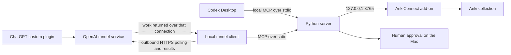
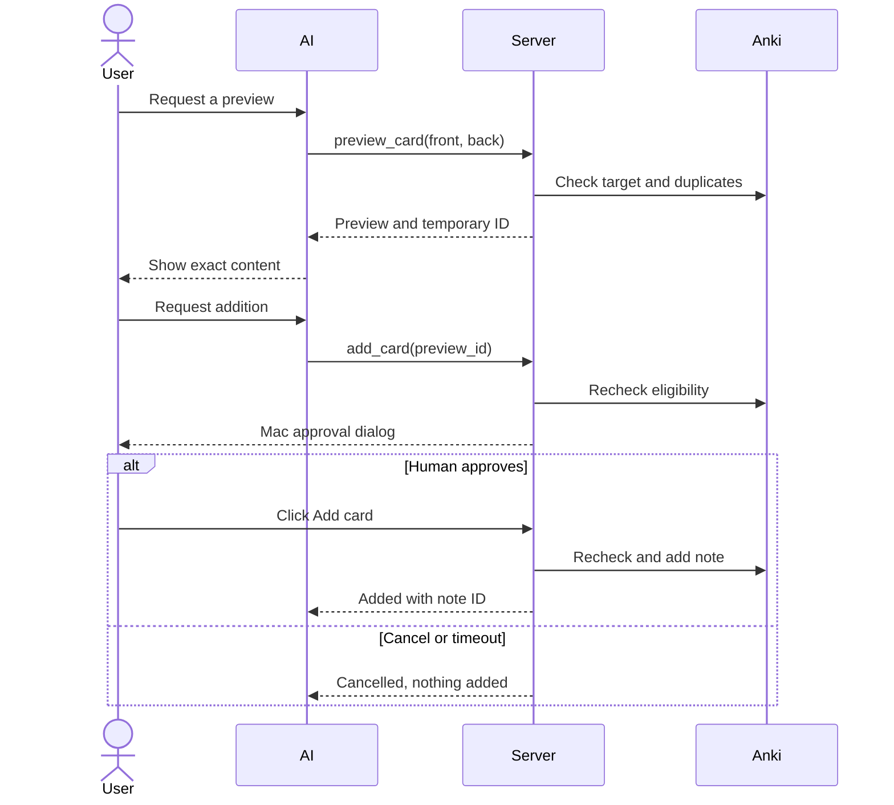

# Anki MCP

A small local Python MCP server for previewing and adding Anki notes through
Codex or a ChatGPT custom plugin. Additions require a native macOS confirmation
dialog, use a single configured deck, and check for duplicates.

This is an MIT-licensed prototype with local and live integration tests on
macOS. The generic configuration has been tested with Anki, Codex Desktop
(read-only tools), and a ChatGPT custom plugin through a Secure MCP Tunnel,
including a human-approved addition and duplicate rejection.

See [TESTING.md](TESTING.md) for the verified scope and remaining limitations.

## Architecture



AnkiConnect is an add-on inside Anki. The ChatGPT custom plugin is a separate
account registration that exposes our MCP tools. Codex can launch the Python
server directly and needs neither the tunnel nor that ChatGPT plugin.

The Python server does not call an AI model. The AI client supplies text; the
server validates it and communicates with local AnkiConnect API v6. AnkiConnect
remains bound to localhost. Each client may start a separate server process,
so previews are not transferable between clients or across server restarts.

## Local setup

Use macOS for the confirmation dialog. The development environment used Python
3.14 and MCP 1.30; other runtime versions are not verified with this lock file.
Install Anki and the [AnkiConnect add-on](https://ankiweb.net/shared/info/2055492159),
and keep Anki open. Leave AnkiConnect on `127.0.0.1:8765`.

From this project's directory:

```sh
python3 -m venv .venv
.venv/bin/python -m pip install -r requirements.lock.txt
cp config.example.json config.local.json
```

Edit `config.local.json` with an **existing** deck and note type. Only `deck`
and `model` are accepted. The note type must have exactly `Front`, `Back` in
that order. The configuration is ignored by Git. No automatic deck creation
or fallback destination is provided. The tool caller cannot change the deck.

```sh
.venv/bin/python -m unittest -v
.venv/bin/python smoke_test.py
```

Use a custom sentence without editing the script:

```sh
.venv/bin/python smoke_test.py \
  --front '朝ご飯を食べた後で、台所を片付けます。' \
  --back '<b>読み</b><br>あさごはんをたべたあとで、だいどころをかたづけます。<br><b>意味</b><br>朝食の後、台所をきれいにします。'
```

Supply both fields together. First run without `--add` and check `can_add`.
Then repeat with `--add`, click Cancel, and run read-only again: the note should
still be eligible. Repeat with `--add` and approve, then run read-only again:
it should be rejected as a duplicate. Use a sentence not already in Anki.
Each invocation creates a fresh preview; no preview IDs need to be copied.

The smoke test connects to real Anki but is read-only by default.
`smoke_test.py --add` requests approval for a real test note. If AnkiConnect
requires an API key, supply `ANKICONNECT_API_KEY` in the launch environment.
Do not put keys in JSON configuration, logs, source control or chats.

## Tools and safeguards

| Tool | Behavior |
|---|---|
| `list_decks()` | Lists all deck names without modifying Anki |
| `preview_card(front, back)` | Validates content, deck, model and duplicate eligibility; returns exact content and a temporary ID |
| `add_card(preview_id)` | Available with `--enable-writes`; adds that stored content only after human approval |



Previews expire after ten minutes and are consumed on an add attempt. A new
preview is needed after failure, cancellation or a restart. The dialog defaults
to Cancel and expires after 45 seconds. Never automate its approval.

Duplicates use Anki's first-field/note-type rules across the collection, not
semantic similarity. Anki's own add call also disallows duplicates. If a write
times out, inspect Anki before retrying because the response may have been lost.

Simple formatting and ruby HTML are allowed, without attributes, scripts,
images or sound directives. Each field is limited to 1500 characters. The Mac
dialog displays HTML source; keep content short enough to review completely.
Added notes receive the `codex-anki` tag for compatibility with the prototype.
Anki's templates and scheduling determine generated cards and review timing.

## Codex configuration

Register the server with absolute paths substituted for these placeholders:

```sh
codex mcp add anki-local -- /absolute/path/to/project/.venv/bin/python /absolute/path/to/project/anki_mcp.py
```

For additions, append `--enable-writes` to the server arguments. Quote paths
if they contain spaces. Set `tool_timeout_sec = 120` in this server's entry in
`~/.codex/config.toml` to accommodate human approval. Use a fresh chat/reload
if tools are missing. See [official MCP configuration](https://developers.openai.com/codex/mcp).

## ChatGPT: Platform tunnel first, custom plugin second

1. In [Platform tunnel settings](https://platform.openai.com/settings/organization/tunnels), create a private tunnel associated with the appropriate Platform organization and ChatGPT workspace. Record its tunnel ID locally.
2. Create a dedicated regular runtime API key with Restricted permissions, Tunnels Read + Use. Creating/managing the registration requires Manage separately. Do not use an Admin key as the runtime key.
3. Download the appropriate official [tunnel-client release](https://github.com/openai/tunnel-client/releases), verify its checksum, and install the executable at `.tools/tunnel-client/tunnel-client`. The earlier prototype used v0.0.21 on Apple Silicon. The executable needs execute permission.
4. Copy `tunnel.example.json` to `tunnel.local.json` and replace its placeholder ID. The launcher generates an ignored YAML profile with paths derived from this folder and an environment reference for the key.
5. Run `.venv/bin/python start_tunnel.py` in your own Terminal. Enter the runtime key only at its hidden prompt. The launcher runs preflight before starting; check readiness, not merely a process-start message. Leave it running.
6. In ChatGPT, open Plugins → Add → Add custom MCP server. Choose a name, Connection: Tunnel, and the matching tunnel. Select No authentication for this server's MCP layer; OpenAI tunnel access controls still apply. Review and approve the connection.
7. Test `list_decks`, then `preview_card`. To enable additions, stop the client with Ctrl+C, restart with `start_tunnel.py --enable-writes`, and refresh tools in ChatGPT's plugin settings. Verify `add_card` appears and create a fresh preview before an approved addition.

Do not run two clients for the same tunnel at once. Platform/ChatGPT access and
labels can vary by account. See [OpenAI's tunnel guide](https://developers.openai.com/api/docs/guides/secure-mcp-tunnels).

The tunnel is outbound-only; no public AnkiConnect listener is needed. Its local
health listener binds to loopback, with the URL written to `.tunnel-health.url`.
`start_tunnel.py` keeps the runtime key in process memory/environment only.
Keep the Mac awake, Anki open and Terminal running; someone must be at the Mac
for additions.

### Background Start/Stop with the Keychain (`tunnelctl.py`)

`tunnelctl.py` is an alternative to keeping a Terminal open. It runs the same
tunnel client in the background, stores the runtime key in the login Keychain,
and refuses to start a second client for the same tunnel.

```sh
.venv/bin/python tunnelctl.py key set               # hidden prompt; saved to Keychain
.venv/bin/python tunnelctl.py start                 # read-only; waits for /readyz
.venv/bin/python tunnelctl.py status                # state, readiness, key, Anki, conflicts
.venv/bin/python tunnelctl.py start --enable-writes # only after `stop`; exposes add_card
.venv/bin/python tunnelctl.py stop
.venv/bin/python tunnelctl.py install-app           # builds build/Anki Tunnel.app
```

- **Key storage:** a generic-password item, service `anki-mcp-tunnel`, account =
  tunnel ID. The key is passed to `security` on stdin, never on a command line,
  and is never written to project files or logs. `key delete` removes it.
  Items created by `security` can be read again by `security` without a
  prompt, so this protects against files leaking, not against other programs
  running as you.
- **Readiness:** `start` runs `tunnel-client doctor`, launches the client, and
  waits up to 45 s for `/readyz` on the loopback health port. `status --check`
  exits 0 when ready, 2 when running but not ready, 1 when stopped.
- **Duplicate prevention:** a lock serializes start/stop; a state file records
  the PID and process start time so a reused PID is never signalled; and every
  running `tunnel-client run` is checked, including foreground `start_tunnel.py`
  clients and other installations. A client for the same or an unreadable tunnel
  ID blocks the start. `start_tunnel.py` performs the same check.
- **Approval dialog:** the MCP server is launched through `env -u
  CONTROL_PLANE_API_KEY`, so it and its dialog never see the runtime key.
  `--enable-writes` is refused outside the logged-in desktop session, where the
  dialog could not appear. Additions still need a human click on "Add card".
- **One-click:** `install-app` builds an AppleScript applet offering Status,
  Start read-only, Start with card additions (with its own confirmation) and
  Stop. Drag it to the Dock. It needs the key already in the Keychain. It reads
  the project path from its bundle, so rebuild it after moving the project.

Runtime state, the client log and the health URL live in the ignored
`.tunnel-run/` folder (mode 0700). There is no login-time startup; start the
tunnel manually. `stop` ends the client and its MCP server; an open approval
dialog closes as Cancel.

## Files and version control

| File | Purpose |
|---|---|
| `anki_mcp.py` | MCP server, Anki client, validation, previews and approval |
| `start_tunnel.py` | Portable profile generation, hidden key prompt and foreground launch |
| `tunnelctl.py` | Background start/stop, Keychain key, readiness, duplicate guard, applet |
| `smoke_test.py` | Live MCP client test, read-only unless `--add` |
| `test_anki_mcp.py`, `test_start_tunnel.py`, `test_tunnelctl.py` | Mocked safety/configuration/path/lifecycle tests |
| `config.example.json`, `tunnel.example.json` | Generic templates for ignored local settings |
| `requirements*.txt` | Direct dependency and frozen environment versions |
| `MIGRATION.md` | Future migration and rollback checklist |
| `IDEAS.md`, `CHANGELOG.md` | Planned work and delivered changes |
| `TESTING.md` | Tested environments, observed results and remaining limits |

Git excludes local settings/profiles, keys, logs, installed dependencies,
downloaded executables and generated media. Review staged content before each
publication; ignore rules do not remove secrets already committed elsewhere.
Anki data, Codex settings and OpenAI account registrations live outside this
repository and require separate backups. Card text/tool results are visible to
the AI service; local execution is not a promise that content stays on the Mac.
The approval guard does not protect against other programs on the Mac using
AnkiConnect directly.

## Collaboration and release status

See [CONTRIBUTING.md](CONTRIBUTING.md) for safe development and test practices.
Keep installation-specific notes in ignored `local-notes/` or `*.local.md` files.
The tracked ideas log and migration guide are generic and useful to contributors.

Before publishing future changes, review staged files and Git history for
credentials or personal configuration and rerun the relevant tests. This
repository backs up source code, not Anki collections or account settings.

## License

Copyright (c) 2026 Gleb Tanaka. Distributed under the [MIT License](LICENSE).
Third-party software, including Anki, AnkiConnect, Python dependencies and the
downloaded tunnel client, remains subject to its respective licenses.
